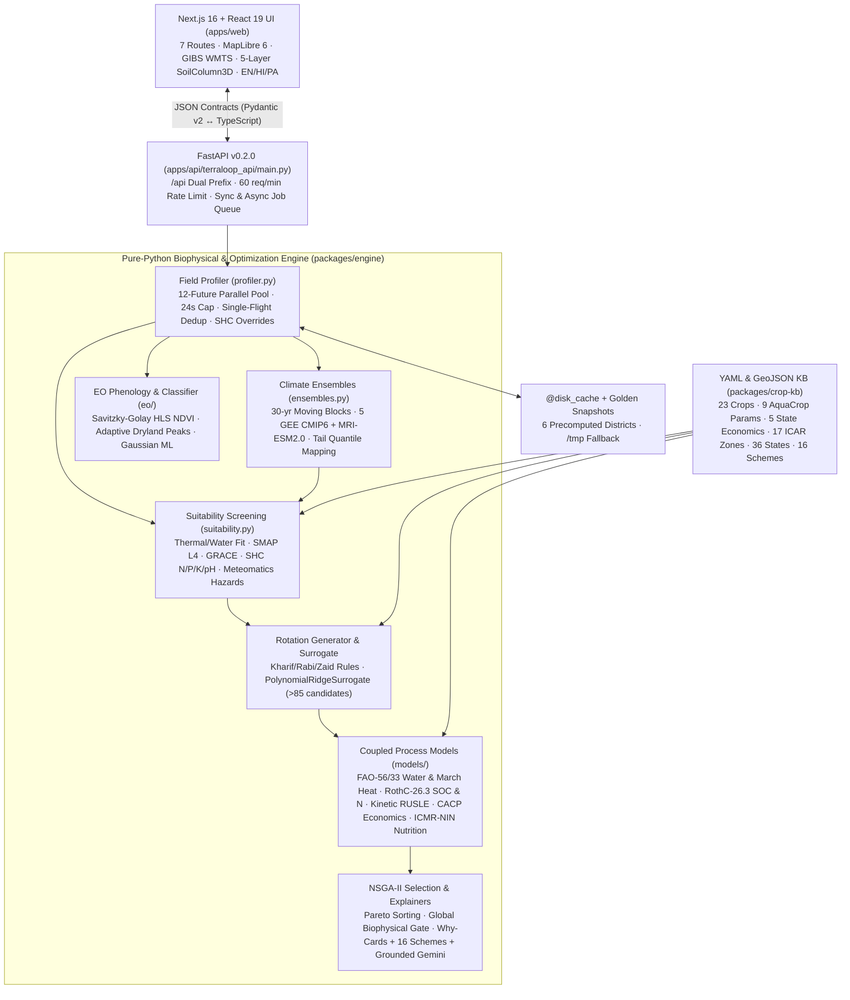

<div align="center">

# TerraLoop ⟳

### Adaptive Crop-Rotation Decision Support Powered by NASA Earth Observations, Biophysical Simulation & Multi-Objective Optimization

[](docs/SUBMISSION.md)
[](LICENSE)
[](pyproject.toml)
[](apps/web/package.json)
[](tests/)
[](apps/web/src/i18n/)

**Turning orbital satellite observations—GRACE-FO, SMAP L4, GPM IMERG, FIRMS, HLS 30 m, NASADEM, POWER & NEX-GDDP-CMIP6—plus 90 m Meteomatics hydrology into profitable, water-saving, burn-free crop rotations expressed in farmer-native units.**

[Overview & Challenge Fit](#-why-terraloop--direct-alignment-with-the-nasa-challenge) •
[Golden Field Results](#-hero-case-study--six-indian-golden-benchmark-fields) •
[Satellite & Sponsor Data](#-nasa-earth-observations-sponsor-meteomatics--ancillary-datasets) •
[Science Engine](#-biophysical--optimization-engine-deep-dive) •
[Web App Tour](#-farmer-first-web-platform-nextjs-16--maplibre-6) •
[API & Quickstart](#-quick-start--local-development) •
[Benchmarks](#-empirical-calibration--reproducible-benchmarks)

</div>

---

## Table of Contents

1. [The Problem TerraLoop Solves](#1-why-terraloop--direct-alignment-with-the-nasa-challenge)
2. [Hero Case Study & Six Indian Golden Benchmark Fields](#2-hero-case-study--six-indian-golden-benchmark-fields)
3. [NASA Earth Observations, Sponsor Meteomatics & Ancillary Datasets](#3-nasa-earth-observations-sponsor-meteomatics--ancillary-datasets)
4. [System Architecture & End-to-End Data Flow](#4-system-architecture--end-to-end-data-flow)
5. [Biophysical & Optimization Engine Deep Dive](#5-biophysical--optimization-engine-deep-dive)
6. [Agronomic Knowledge Base, Zones & Government Schemes](#6-agronomic-knowledge-base-zones--government-schemes)
7. [Empirical Calibration & Reproducible Benchmarks](#7-empirical-calibration--reproducible-benchmarks)
8. [Farmer-First Web Platform (Next.js 16 + MapLibre 6)](#8-farmer-first-web-platform-nextjs-16--maplibre-6)
9. [FastAPI Backend & Shared Schemas](#9-fastapi-backend--shared-schemas)
10. [Quick Start & Local Development](#10-quick-start--local-development)
11. [Environment Variables Reference](#11-environment-variables-reference)
12. [Utility Scripts, Testing, CI/CD & Deployment](#12-utility-scripts-testing-cicd--deployment)
13. [Complete Repository Structure](#13-complete-repository-structure)
14. [Honest Limitations, Scientific Boundaries & References](#14-honest-limitations-scientific-boundaries--references)

---

## 1. Why TerraLoop? — Direct Alignment with the NASA Challenge

Farmers across India and climate-stressed agricultural basins navigate compounding environmental shocks simultaneously: groundwater depletion, erratic monsoons, late-season terminal heatwaves, post-harvest burning windows, and declining soil organic carbon. **TerraLoop** bridges NASA satellite Earth science and farm-gate economics inside one fast, transparent decision-support platform.

| Challenge Pressure | Orbital / Local Signal Used | Biophysical Mechanism Modeled | Actionable Farmer Output |
| :--- | :--- | :--- | :--- |
| **Shifting Temperatures** | NASA POWER (`T2M_MAX/MIN`) + IMD/MERRA-2 IGP bias lookup | Grain-filling thermal sterility ($T_{\max} > 32.0^\circ\text{C}$, final 35% of Rabi cycle) + Happy Seeder canopy cooling ($-1.0^\circ\text{C}$) | Cuts `+4.5°C` March heatwave wheat yield loss from **-16.7% to -10.8%** |
| **Changing Rainfall Patterns** | GPM IMERG V07 (`0.1°`) + Meteomatics 90m `precip_30min` | Monsoon onset, longest dry spells, extreme rain days (`>50 mm`), kinetic RUSLE erosivity ($EI_{30}$) | Schedules resilient crops & warns on heavy convective storm erosion |
| **Water Shortages & Aquifers** | NASA GRACE/GRACE-FO mascons + NASA SMAP L4 (`SPL4SMGP V008`) | Aquifer depletion urgency scaler ($1.0\times\text{–}1.5\times$), PTR ponded percolation (`3.5 mm/d`) vs DSR+AWD (`2.55 mm/d`) | Cuts irrigation **17.6–60.1%**; displays **borewell pumping hours** & **75 mm irrigations saved** |
| **Extreme Weather & Stubble Burning** | NASA FIRMS (MODIS/VIIRS fires) + HLS 30 m phenology | Harvest-to-sowing turnaround math (`rice_puddled` 11 d vs `rice_dsr` 26 d vs `rice_short` PR-126 30 d vs maize/pulses 34 d) | Eliminates forced October stubble burning via 26–34 d zero-till windows |
| **Declining Soil Health** | ISRIC SoilGrids 2.0 (250 m) + Govt Soil Health Card (`N/P/K/pH/SOC`) | 10-year 5-pool **RothC-lite 26.3** SOC dynamics + species-specific legume BNF + residue N balance + 0–100 NRCS Soil Health Index | Forecasts 10-yr soil carbon accretion & **45-kg Urea bags saved/ha** |
| **Local Soil & Crop Reality** | 23 Crop YAMLs + 9 AquaCrop params + 36 Indian States/UTs + 17 Zones | Saxton–Rawls (`FC`/`WP`), USDA 12-class texture, 5-state CACP 2024–25 A2+FL costs, 16 Central/State subsidies | Recommends exact crops, sowing dates, Happy Seeder practices & matched subsidies |
| **Farmer Priorities & Downside Risk** | 6 farmer priority weights + 30-yr / NEX-GDDP-CMIP6 ensembles | Pure-NumPy **NSGA-II** Pareto frontier, diversity filtering, and drought-tail **$CVaR_{10}$** downside profit | Ranked top-3 strategies with `/Acre (Killa)` toggle & **English / हिन्दी / ਪੰਜਾਬੀ** UI |

---

## 2. Hero Case Study & Six Indian Golden Benchmark Fields

### Hero Story: Sangrur, Punjab (`30.19°N, 75.78°E`)

Across the Trans-Gangetic alluvial plains of Punjab, NASA GRACE-FO mascon observations measure regional groundwater drawdown of **`-4.15 cm/yr`** (`-3.85 cm/yr` central zone baseline), while NASA FIRMS detects dense October–November residue fire clusters driven by a compressed **11-day** gap between long-duration puddled rice harvest and optimal wheat sowing.

All strategies below are computed directly by `terraloop_engine` and persisted in [`data/golden/sangrur/recommendations.json`](data/golden/sangrur/recommendations.json) (`demo_snapshot`, `2026-11-13`):

| Strategy | Net Irrigation (mm/yr) | Water & Borewell Savings vs Baseline | Kharif→Rabi Turnaround | 10-Yr SOC Delta (RothC) | Soil Health Score | 45-kg Urea Saved/ha | Median Net Profit (`P50`) | Drought Tail (`CVaR-10`) |
| :--- | :---: | :---: | :---: | :---: | :---: | :---: | :---: | :---: |
| **Baseline:** `Puddled Rice → Wheat → Fallow` | `1,168.0` | Baseline (`0%`) | `11 days` (High burn risk) | **`-1.92 t C/ha`** | `22.3 / 100` | `0.0 bags` | `₹170,334 /ha` | `₹77,208 /ha` |
| **Rank #1:** `DSR Rice → Sunflower → Mung bean` | **`962.1`** | **-17.6%** (`3 irr.`, `113 pump hrs/ha`) | **`26 days`** (Burn-free) | **`+3.01 t C/ha`** | **`87.7 / 100`** | **`3.5 bags`** | **`₹271,978 /ha`** | **`₹217,384 /ha`** |
| **Rank #2:** `Maize → Sunflower → Mung bean` | **`466.3`** | **-60.1%** (`9 irr.`, `386 pump hrs/ha`) | **`34 days`** (Burn-free) | **`+3.29 t C/ha`** | **`85.2 / 100`** | **`3.5 bags`** | `₹230,542 /ha` | `₹165,596 /ha` |
| **Rank #3:** `Mung bean → Wheat → Blackgram` | **`584.4`** | **-50.0%** (`8 irr.`, `321 pump hrs/ha`) | **`34 days`** (Burn-free) | **`+1.42 t C/ha`** | **`78.1 / 100`** | **`4.1 bags`** | `₹214,188 /ha` | `₹196,628 /ha` |

### Six Precomputed Indian Benchmark Fields (`data/golden/<id>/`)

All six agro-climatically distinct benchmark parcels work **100% offline** in both FastAPI and Next.js:

| Field ID & Location | Agro-Climatic Zone | Soil & Climate Summary | GRACE TWS Trend | Baseline Strategy | Rank #1 Recommended Strategy | Irrigation Change | Median Profit (`₹/ha`) | 10-Yr SOC Δ (`t C/ha`) | Soil Health |
| :--- | :--- | :--- | :---: | :--- | :--- | :---: | :---: | :---: | :---: |
| **`sangrur`** Punjab (`30.19, 75.78`) | Trans-Gangetic Alluvial Plains | Loam (pH 8.0) · 648 mm rain · 1,762 mm ET0 | `-4.15 cm/yr` | `Puddled Rice → Wheat → Fallow` | `DSR Rice → Sunflower → Mung bean` | **-17.6%** | `₹271,978` | `+3.01` | `87.7/100` |
| **`ludhiana`** Punjab (`30.82, 75.68`) | Trans-Gangetic Alluvial Plains | Clay loam (pH 7.8) · 747 mm rain · 1,717 mm ET0 | `-4.15 cm/yr` | `Puddled Rice → Wheat → Fallow` | `DSR Rice → Sunflower → Blackgram` | **-18.8%** | `₹293,344` | `+3.27` | `87.5/100` |
| **`bathinda`** Punjab (`30.12, 74.86`) | Trans-Gangetic Semi-Arid Belt | Loam (pH 8.0) · 446 mm rain · 1,785 mm ET0 | `-4.15 cm/yr` | `Cotton → Wheat → Fallow` | `Mung bean → Wheat → Blackgram` | **-36.9%** | `₹191,788` | `+1.37` | `76.1/100` |
| **`bundelkhand`** Jhansi, UP (`25.38, 78.62`) | Central Plateau & Hills | Loam (pH 7.4) · 738 mm rain · 1,936 mm ET0 | `+0.39 cm/yr` | `Sorghum → Wheat → Fallow` | `Pigeon pea → Barley → Fallow` | `0.0%` (Rainfed) | `₹94,040` | `+0.96` | `67.8/100` |
| **`vidarbha`** Yavatmal, MH (`20.39, 78.13`) | Western/Central Deccan Vertisol | Clay (43% clay, pH 6.9) · 1,025 mm rain · 1,905 mm ET0 | `+1.11 cm/yr` | `Cotton → Chickpea → Fallow` | `Maize → Chickpea → Fallow` | `0.0%` (Rainfed) | `₹119,939` | `+0.69` | `63.5/100` |
| **`thanjavur`** Cauvery Delta, TN (`10.72, 79.25`) | East Coast Plains & Deltas | Clay loam (pH 6.7) · 1,019 mm rain · 1,900 mm ET0 | `+0.55 cm/yr` | `Puddled Rice → Puddled Rice → Blackgram` | `Groundnut → DSR Rice → Blackgram` | **-56.2%** | `₹292,517` | `+2.29` | `83.5/100` |

---

## 3. NASA Earth Observations, Sponsor Meteomatics & Ancillary Datasets

Every number exposed by TerraLoop carries a structured `DataProvenance` object (`source`, `product`, `period`, `resolution`, `doi`, `url`, `mode`), tracked in [`docs/DATASETS.md`](docs/DATASETS.md).

### NASA Earth Observations & Earthdata Products

| Dataset | Product / GEE / WMTS Collection | Spatial & Temporal Resolution | Role in TerraLoop | Module | DOI / URL |
| :--- | :--- | :--- | :--- | :--- | :--- |
| **NASA POWER** | REST `temporal/daily/point` (`AG` community) | `0.5° × 0.625°`, daily (1981+) | Tmax/Tmin, solar radiation, RH, wind → Penman–Monteith ET0, GDD, climate ensembles | `data/nasa_power.py` | [`power.larc.nasa.gov`](https://power.larc.nasa.gov/) |
| **GPM IMERG V07** | `NASA/GPM_L3/IMERG_V07` | `0.1°`, 30-min → daily (2000–2024) | Homogeneous rainfall totals, longest dry spells, extreme rain days (`>50 mm`), RUSLE $R$ | `data/gee.py::imerg_daily` | `10.5067/GPM/IMERG/3B-HH/07` |
| **SMAP L4** | `NASA/SMAP/SPL4SMGP/008` | `9 km`, 3-hourly (2015–2024) | Root-zone moisture percentiles (Rabi/post-monsoon suitability modulation `>60%` / `<35%`) | `data/gee.py::smap_rootzone` | `10.5067/K2VT90DE20GV` |
| **GRACE / GRACE-FO** | `NASA/GRACE/MASS_GRIDS_V04/MASCON_CRI` | `~0.5°` grid (`~3°` native mascon), monthly | Aquifer TWS trend (`cm/yr`) → scales optimization `water_savings` weight `1.0x–1.5x` | `data/gee.py::grace_trend` | `10.5067/TEMSC-3MJ62` |
| **NASADEM** | `NASA/NASADEM_HGT/001` | `30 m` | Elevation & terrain slope % → RUSLE $LS$ slope-steepness factor | `data/gee.py::slope_pct` | `10.5067/MEaSUREs/NASADEM/NASADEM_HGT.001` |
| **FIRMS Active Fire** | `FIRMS` (MODIS / VIIRS) | `375 m – 1 km` (2019–2024) | Historical Oct–Nov crop-residue burning detection | `data/gee.py::fire_detections` | [`firms.modaps.eosdis.nasa.gov`](https://firms.modaps.eosdis.nasa.gov/) |
| **HLS Landsat L30** | `NASA/HLS/HLSL30/v002` | `30 m`, 2–3 day composite | 30 m NDVI phenology curve extraction → baseline crop classification | `data/gee.py::ndvi_timeseries` | `10.5067/HLS/HLSL30.002` |
| **HLS Sentinel-2 S30** | `NASA/HLS/HLSS30/v002` | `30 m`, 2–3 day composite | Harmonized high-cadence NDVI gap filling for Kharif/Rabi/Zaid seasons | `data/gee.py::ndvi_timeseries` | `10.5067/HLS/HLSL30.002` |
| **NEX-GDDP-CMIP6** | `NASA/GDDP-CMIP6` | `0.25°`, daily (2015–2100) | 5 downscaled GCMs under SSP2-4.5 & SSP5-8.5 (2030s & 2050s stress lab) | `data/gee.py::cmip6_daily` | `10.7917/OASIS/NEX-GDDP-CMIP6` |
| **NASA GIBS WMTS** | `VIIRS_SNPP_CorrectedReflectance_TrueColor`, `SMAP_L4_Analyzed_Root_Zone_Soil_Moisture`, `MODIS_Terra_NDVI_8Day` | `250 m – 9 km` (`EPSG:3857` WMTS) | Interactive **context only** satellite raster overlays inside `FieldMap.tsx` | `apps/web/src/components/FieldMap.tsx` | [`nasa-gibs.github.io`](https://nasa-gibs.github.io/gibs-api-docs/) |

### Meteomatics 90 m Sponsor API (`data/meteomatics.py`)

When `METEOMATICS_USERNAME` and `METEOMATICS_PASSWORD` are configured, TerraLoop fuses four sponsor data streams (degrading cleanly when unset or offline):

| Sponsor Dataset | Queried Parameters | Resolution | Role in Engine & UI |
| :--- | :--- | :---: | :--- |
| **Weather & SRTM Microclimate (`MIX`)** | `t_max_2m_24h:C`, `t_min_2m_24h:C`, `precip_24h:mm`, `precip_30min:mm`, `prob_precip_24h:p`, `global_rad_24h:Wh`, `relative_humidity_2m:p`, `wind_speed_2m:ms`, `evapotranspiration_24h:mm`, `elevation:m` | `90 m`, daily / sub-hourly | Recent 90-day weather overlay, live 7-day `/tactical-advisory` sowing & spray windows, $I_{30}$ storm intensity for kinetic RUSLE, SRTM slope fallback |
| **4-Layer Soil Hydrology** | `soil_moisture_deficit:mm`, `soil_moisture_index_-5cm/-15cm/-50cm/-150cm:idx`, `volumetric_soil_water_-5cm/-15cm/-50cm/-150cm:m3m3`, `t_-5cm:C` | `90 m`, daily | Couples live initial root-zone moisture deficit (`initial_depletion_mm`) into FAO-56 (`Dr_0`) and surfaces 5 cm seedbed temperature |
| **Agro-Hazards & Extreme Events** | `phytophthora_negative:idx`, `leaf_wetness:idx`, `hail_24h:cm`, `fosberg_fire_weather_index:idx`, `drought_index:idx` | `90 m`, daily | Screens potato blight, fungal canopy wetness, hail risk (`cotton`/`sunflower`), turnaround fire danger & drought severity |
| **Downscaled CMIP6 (`MRI-ESM2.0`)** | `source=mri-esm2` (`ssp126`, `ssp245`, `ssp370`, `ssp585`) | `90 m`, daily (1995–2100) | 6th CMIP6 ensemble member alongside GEE GCMs, plus zero-GEE REST climate fallback |

### Credited Scientific & Regional Baselines

| Dataset / Standard | Role | Source / Module |
| :--- | :--- | :--- |
| **ISRIC SoilGrids 2.0 (250 m)** | Topsoil depth-weighted (`0–5`, `5–15`, `15–30 cm`) clay, sand, silt, SOC, pH, bulk density, CEC & N; includes 3 km rural offset search + GEE fallback | `data/soilgrids.py` (`10.5194/soil-7-217-2021`) |
| **Govt Soil Health Card (SHC)** | Farmer lab input overrides (`ph`, `soc_pct`, `available_n_kg_ha`, `available_p_kg_ha`, `available_k_kg_ha`) overriding satellite priors | `profiler.py`, `suitability.py`, `ReportCard.tsx` |
| **ESA WorldCereal 10 m** | Regional phenology reference curves for `PhenologyCropClassifier` | `eo/classifier.py`, `eo/phenology.py` |
| **DES & ICRISAT DLD** | Published 5-year district yield ground truth across 6 Indian districts | `data/benchmarks/district_ground_truth.csv` |
| **CGWB / India-WRIS** | Aquifer observation baseline cross-validating GRACE-FO groundwater trends | `data/gee.py::grace_trend` |
| **FAO-56, FAO-33 & CACP 2024–25** | Dual Kc, $K_y$, Saxton–Rawls, PAU Package of Practices, MSP & A2+FL cultivation budgets | `packages/crop-kb/`, `models/` |

### Four-Tier Provenance & Global Honesty Modes

- **`observed`:** Live NASA/GEE/Meteomatics/ISRIC telemetry for the coordinate.
- **`hybrid`:** Partial live observations supplemented cleanly with regional baselines where an individual sensor timed out.
- **`regional_climatology` / `demo_snapshot`:** Validated ICAR/PAU zone climatology or precomputed golden snapshots (`is_fallback=True` flagged visually on degraded profiles).
- **`unvalidated_global` (Outside India):** Locations outside the 36 Indian States/UTs polygon display global latitude-band climatology and proxy USD currencies; `selection.select_top(..., allow_economic_ranking=False)` zeros India-proxy economic objectives (`profit`, `low_risk`, `low_labour`) so ranking is governed purely by **water savings, soil health, and food security** alongside explicit frontend scope banners.

---

## 4. System Architecture & End-to-End Data Flow



---

## 5. Biophysical & Optimization Engine Deep Dive

All process models in [`packages/engine/terraloop_engine/models/`](packages/engine/terraloop_engine/models/) are deterministic pure functions accepting scalars, NumPy arrays, or pandas DataFrames—with zero HTTP requests or unseeded randomness:

| Module | Governing Physics / Economics / Math | Verified Details |
| :--- | :--- | :--- |
| **`models/agroclimate.py`** | **FAO-56 Penman–Monteith ET0** primary + **Hargreaves–Samani ET0** fallback | Switches automatically when solar radiation, RH, and wind pass 50% coverage; IGP MERRA-2 12-month `Tmax` bias lookup corrects March warm bias by `-4.5°C` (`Ambika & Mishra 2019`) |
| **`models/soil.py`** | **USDA 12-Class Texture** + **Saxton & Rawls (2006)** pedotransfer | Maps sand/silt/clay + SOC to $\theta_{\text{FC}}$, $\theta_{\text{WP}}$, Total Available Water ($\text{TAW}$), Readily Available Water ($\text{RAW}$) |
| **`models/fao56_runner.py`** | **FAO-56 Dual-$K_c$ Daily Soil-Water Balance** + **FAO-33 $K_y$ Yield Response** | Models rice puddling (`175 mm` + `3.5 mm/d` percolation) vs DSR+AWD (`75 mm` *rauni* + `2.55 mm/d`), Happy Seeder mulch (`-10%` $K_c$ evap, `-1.0°C` canopy cooling), March wheat grain-fill heat (`>32.0°C` at `0.018/°C·d`), Meteomatics `initial_depletion_mm`. (`aquacrop_runner.py` kept as compatibility shim) |
| **`models/soil_health.py`** | **RothC-Lite 26.3** + **Symbiotic N Mass Balance** + **0–100 Composite Index** | Tracks `DPM/RPM/BIO/HUM/IOM` monthly over 10 yrs; species-specific legume N credit `clip(n_fix * (0.50 if retained else 0.35), 15, 45)` + `12 kg/ha` residue N + SHC N credit; **Soil Health Score** = `5×15 NRCS Principles` + `SOC (-10..+15)` + `RUSLE (-10..+3)` + `SoilCond (-5..+5)` − `BurnPenalty (5)` |
| **`models/rusle.py`** | **Kinetic RUSLE** ($A = R \cdot K \cdot LS \cdot C \cdot P$) | `r_factor_intensity` weights Renard–Freimund $R$ with Brown–Foster / Wischmeier–Smith storm energy $I_{30}$ (`>25 mm/h`) and extreme rain days (`>50 mm`) while guarding dry snapshot days against suppression |
| **`models/economics.py`** | **CACP 2024–25 A2+FL Crop Budgets** + Risk Tail ($CVaR_{10}$) | Multi-state YAML budgets (`punjab`, `haryana`, `uttar_pradesh`, `maharashtra`, `tamil_nadu`, else labeled `punjab_proxy`); pumping/practice cost deltas + `-₹650/ha` legume fertilizer credit; median `P50`, `P10/P90`, and $CVaR_{10}$ with bootstrap CI |
| **`models/nutrition.py`** | **ICMR-NIN (2020)** Energy & Protein Yield | Computes `annual_energy_mcal_ha`, `annual_protein_kg_ha`, `households_nourished` (Liebig minimum against 5-member household RDA: `4,015 Mcal/yr`, `91.25 kg protein/yr`) & `[0, 1]` `food_security_score` |
| **`models/surrogate.py`** | **Pure-NumPy Degree-2 Polynomial Ridge Surrogate** | Activates inside `main.py` whenever generated rotation candidates exceed **85** (`len > 85`) to pre-screen high-volume multi-year pools safely |
| **`eo/phenology.py` & `eo/classifier.py`** | **Savitzky–Golay HLS NDVI** + **Gaussian ML Crop Classifier** | 5-day resampling, 9-point poly-2 Savitzky–Golay filter, adaptive dryland peak detection (`0.07` prominence floor on sparse Vertisols), circular-DOY wrapping across year boundaries |
| **`optimize/selection.py`** | **NSGA-II Non-Dominated Sorting** + Diversity Filter | Normalizes 6 objectives using `MIN_SPREADS` noise guards (`₹5,000` profit/CVaR, `25 mm` water, `5 pts` soil, `₹2,000` labour, `0.10` nutrition), scales `water_savings` by GRACE urgency (`1.0x–1.5x`), enforces distinct `(Kharif, Rabi)` primary pairs |
| **`explain/why_cards.py`** | **Deterministic Trilingual Templates** + **Grounded Gemini Guard** | Produces native `en`/`hi`/`pa` cards + Urea bags (`÷20.7 kg N`), pumping hours (`×0.55`), `75 mm` irrigations, and turnaround days. Optional Gemini synthesis uses a 2.5 s timeout + cooldown circuit breaker and rejects any LLM text failing `verify_llm_numeric_grounding` (5% tolerance) |

---

## 6. Agronomic Knowledge Base, Zones & Government Schemes

All crop, regional, economic, and policy data is declarative YAML/GeoJSON inside [`packages/crop-kb/`](packages/crop-kb/):

### 23 Supported Crops (`packages/crop-kb/crops/*.yaml` + 9 `aquacrop_params/*.yaml` overrides)

- **Cereals (9):** Puddled Rice (`rice_puddled`), Short-Duration PR-126 Rice (`rice_short`), Direct-Seeded Rice (`rice_dsr`), Basmati (`basmati`), Wheat (`wheat`), Kharif Maize (`maize`), Pearl Millet / Bajra (`pearl_millet`), Sorghum / Jowar (`sorghum`), Barley (`barley`)
- **Legumes / Pulses (7, fixing 45–80 kg N/ha):** Chickpea (`chickpea`, `60 kg N`), Mung Bean / Moong (`moong`, `50 kg N`), Blackgram / Urad (`urad`, `55 kg N`), Pigeon Pea / Arhar (`pigeon_pea`, `60 kg N`), Lentil (`lentil`, `50 kg N`), Soybean (`soybean`, `80 kg N`), Common Bean / Rajma (`common_bean`, `45 kg N`)
- **Oilseeds (3):** Mustard (`mustard`), Sunflower (`sunflower`), Groundnut (`groundnut`, fixing `65 kg N/ha`)
- **Fibre, Tuber, Fodder & Green Manure (4):** Cotton (`cotton`), Autumn Potato (`potato`), Berseem Clover (`berseem`, `100 kg N/ha`), Dhaincha Green Manure (`dhaincha`, `80 kg N/ha`)

### Pan-India Zones, State Budgets & 16 Matched Schemes

- **36 Indian States & Union Territories** resolved via point-in-polygon + `0.04°` coastal boundary snap (`packages/crop-kb/regions/india_states.geojson`).
- **17 Named ICAR Agro-Climatic Zones** (+ `default_zone`): `punjab_central`, `punjab_southwest`, `haryana`, `bundelkhand`, `vidarbha`, `western_maharashtra`, `western_up`, `cauvery`, `rajasthan_arid`, `gujarat`, `eastern_gangetic`, `southern_hills`, `west_coast`, `himalayan`, `eastern_himalayan`, `central_malwa`, `islands`.
- **5 State CACP 2024–25 Economic Tables** (covering all 23 crops per state): `punjab.yaml`, `haryana.yaml`, `uttar_pradesh.yaml`, `maharashtra.yaml`, `tamil_nadu.yaml`.
- **16 Central & State Government Subsidies (`packages/crop-kb/schemes/*.yaml`):**
  - *Central (4):* `PM-PRANAM`, `NFSM-Pulses & NAFED e-Samridhi`, `NMEO-Oilseeds`, `SMAM Mechanization`
  - *Punjab (3):* `Punjab DSR Promotion`, `Punjab Crop Diversification`, `CRM Happy Seeder / Super Seeder`
  - *Uttar Pradesh (4):* `Bundelkhand Drought & Pulses Package`, `UP CRM`, `UP Pulses/Oilseeds Minikit`, `UP DSR Diversification`
  - *Maharashtra (2):* `Maharashtra PoCRA`, `In-Situ Moisture Conservation`
  - *Tamil Nadu (2):* `Kalaignarin Rice Fallow Pulses Mission`, `Sustainable Dryland & Water Conservation`
  - *Haryana (1):* `Mera Pani Meri Virasat`

---

## 7. Empirical Calibration & Reproducible Benchmarks

> Every number in [`docs/BENCHMARKS.md`](docs/BENCHMARKS.md) is **generated directly by code** via `uv run python scripts/run_validation_benchmarks.py --write-docs` and verified on every push with `git diff --exit-code docs/BENCHMARKS.md`.

### Calibration vs. Held-Out Indian District Evaluation (`district_ground_truth.csv`)

| Role | District | Crop & Regime | Observed Mean (t/ha) | Simulated Median (t/ha) | Relative Error | Source |
| :--- | :--- | :--- | :---: | :---: | :---: | :--- |
| **Calibration** | Sangrur, Punjab | Rabi Wheat (Irrigated) | `5.08` | **`5.25`** | **+3.4%** | DES Punjab Statistical Abstract 2023 |
| **Calibration** | Sangrur, Punjab | Kharif Paddy (Rough Rice) | `7.35` | **`7.54`** | **+2.5%** | DES Punjab Statistical Abstract 2023 |
| **Held-Out** | Ludhiana, Punjab | Rabi Wheat (Irrigated) | `5.02` | **`5.27`** | **+5.0%** | DES Punjab / ICRISAT DLD |
| **Held-Out** | Ludhiana, Punjab | Kharif Paddy (Rough Rice) | `7.20` | **`7.55`** | **+4.9%** | DES Punjab / ICRISAT DLD |
| **Held-Out** | Bathinda, Punjab | Rabi Wheat (Limited Irr.) | `4.82` | **`5.05`** | **+4.8%** | DES Punjab Statistical Abstract 2023 |
| **Held-Out** | Thanjavur, Tamil Nadu | Irrigated Paddy | `5.85` | **`6.29`** | **+7.4%** | DES Tamil Nadu Table 4.4 |
| **Held-Out** | Yavatmal, Maharashtra | Kharif Cotton (Rainfed) | `1.35` | **`2.00`** | `+48.1%` | DES APY (*unmodeled pink bollworm / boll rot*) |
| **Held-Out** | Yavatmal, Maharashtra | Rabi Gram (Rainfed) | `1.15` | **`0.77`** | `-33.5%` | DES APY |
| **Held-Out** | Jhansi, Uttar Pradesh | Kharif Sorghum (Rainfed) | `1.32` | **`1.70`** | `+28.8%` | DES APY (*marginal unfertilized subsoils / bird loss*) |

### Key Process Sensitivity Highlights (`docs/BENCHMARKS.md`)

- **Soil Texture Hydraulics:** Rainfed wheat responds sharply from **`1.29 t/ha`** on Coarse Loamy Sand (`FC 0.129`) to **`2.30 t/ha`** on Alluvial Loam (`FC 0.254`) and **`2.37 t/ha`** on Deccan Vertisol Clay (`FC 0.424`), while DSR irrigation ranges from `1,162 mm` on sand to `691 mm` on loam.
- **March Heatwave & Mulch Buffering:** A `+4.5°C` March–April terminal heatwave depresses conventional wheat by **`-16.7%`** (`4.90 → 4.08 t/ha`); Happy Seeder mulch (`-1.0°C` cooling) buffers loss to **`-10.8%`** (`4.37 t/ha`).
- **Rice Hydrology & Stubble Turnaround:** Switching from Puddled Long-Duration Rice (`845 mm`, `11 d` turnaround) cuts seasonal rice irrigation by **`21.5%`** with PAU `PR-126` (`663 mm`, `30 d` turnaround) and **`26.2%`** with `DSR + AWD` (`623 mm`, `26 d` turnaround).
- **10-Yr RothC Carbon & Soil Health Components:** Conventional rice–wheat with residue burning scores **`25.4 / 100`** (`-1.92 t C/ha/10yr`), while `DSR → Zero-Till Wheat → Moong` scores **`86.4 / 100`** (`+3.74 t C/ha/10yr`) and `Maize → Happy Seeder Wheat → Moong` reaches **`+4.01 t C/ha/10yr`** (`84.7 / 100`, `34 d` turnaround).
- **Meteomatics Kinetic RUSLE & Seedbed Deficit:** Cloudburst intensity ($I_{30} = 55\text{ mm/h}$) elevates effective RUSLE $R$ from `1,624.4` to **`1,837.6`** (`+13.1%`) while dry snapshot days (`0.0 mm/h`) preserve baseline $R$ unchanged. Increasing `initial_depletion_mm` from `15 mm` to `80 mm` adds `+24.7 mm` puddled rice soaking demand vs `+18.0 mm` under DSR.

---

## 8. Farmer-First Web Platform (Next.js 16 + MapLibre 6)

Designed for mid-range Android devices over low-bandwidth connections, with **739 synchronized i18n keys** across **English (`en`)**, **Hindi (`hi` — हिन्दी)**, and **Punjabi (`pa` — ਪੰਜਾਬੀ)** plus a 1-click **`/Acre (Killa)` vs `/Ha`** unit switcher.

### 7 Dedicated Application Routes (`apps/web/src/app/`)

1. **`/` — Field Command & Orbital Explorer:** Interactive 3D MapLibre terrain (`FieldMap.tsx`) with extruded parcel footprints, Esri World Imagery / OSM / **NASA GIBS WMTS context-only overlays** (SMAP L4, MODIS NDVI 8-Day, VIIRS True Color), coordinate/address/Google Maps URL geocoder, live 7-day operational Meteomatics `TelemetryBar`, and interactive 5-layer HTML5 Canvas **`SoilColumn3D`** visualization.
2. **`/diagnostics` — Satellite & Lab Soil Report Card:** Monthly rainfall hyetograph, Saxton–Rawls hydraulic curve, GRACE aquifer gauge, Meteomatics blight/hail/fire hazards, HLS NDVI EO baseline crop confirmation, and **Government Soil Health Card (SHC)** lab entry form (`pH`, `SOC %`, `N`, `P`, `K`).
3. **`/rotations` — Multi-Objective Rotation Explorer:** 5 quick priority personas (*Balanced*, *Profit Max*, *Water Saver*, *Soil Regeneration*, *Climate Resilient*), fine-grained priority weights, `1/2/3-year` planning horizons, irrigation/must-grow/exclude/livestock constraints, async simulation progress ring, Seasonal Gantt calendar (NH & SH seasons), and 6-axis USDA Soil Health Radar + component audit table.
4. **`/lab` — Pareto Frontier & Climate/Price Stress Lab:** Switch between 2D/3D interactive Pareto trade-off plots (`Profit × Water × Soil Health`) and the What-If Shock Simulator pairing historical moving blocks or NEX-GDDP-CMIP6 (`SSP2-4.5` & `SSP5-8.5` for 2030s/2050s) with custom drought (`%`), harvest price (`%`), and urea cost (`%`) shocks.
5. **`/crops` — 23-Crop Agronomic Atlas:** Filterable botanical library with dual-$K_c$ transpiration curves, GDD ceilings, thermal tolerance bands, N fixation vs N demand balances, and good/bad predecessor compatibility pills.
6. **`/brief` — Printable KVK Agronomic Prescription:** Print/PDF-ready farmer field brief featuring a holding-size scaler (Marginal `0.5 ha` to FPO Co-op), total Urea bags & pumping hours saved, localized why-cards, unmodeled risks disclosure, and automatically matched Central/State subsidy cards.
7. **`/methodology` — Open-Science Provenance & Equations Reference:** Transparent ledger of every NASA/Meteomatics/ancillary DOI, resolution, governing equation, and validation scope note.

---

## 9. FastAPI Backend & Shared Schemas

All API contracts live in [`packages/schemas/terraloop_schemas/models.py`](packages/schemas/terraloop_schemas/models.py) (Pydantic v2) and mirror [`apps/web/src/types/api.ts`](apps/web/src/types/api.ts), verified by `test_schema_typescript_interface_parity`.

### 12 Endpoints (`apps/api/terraloop_api/main.py`)

Routes are dual-served both at root (`/...`) and `/api/...` via `_PathPrefixMiddleware`, protected by a sliding-window per-IP rate limiter (`TERRALOOP_RATE_LIMIT_PER_MIN=60`) on `/recommend`, `/profile`, `/tactical-advisory`, `/suitability`, and `/geocode`:

| Method & Path | Description |
| :--- | :--- |
| `GET /health` | Service health check (`status`, `version`, `crops_loaded`, `gee_live`, `meteomatics_configured`) |
| `GET /tactical-advisory` | Live 7-day sowing, irrigation & spray window advisory for `lat`, `lon` (Meteomatics 90m or regional fallback) |
| `GET /crops` | Returns all 23 `CropSpec` entries loaded from `packages/crop-kb/` |
| `GET /golden` | Lists all 6 Indian benchmark parcel summaries |
| `GET /golden/{field_id}/profile` | Instant precomputed `FieldProfile` snapshot for a benchmark parcel |
| `GET /golden/{field_id}/recommendations` | Instant precomputed baseline + top-3 `StrategyRecommendation` bundle |
| `GET /geocode?q=...` | Parses coordinates, Google Maps URLs offline, or geocodes via Nominatim (1 req/s rate-throttled) |
| `POST /profile` | Builds full `FieldProfile` (`FieldGeometry`, polygon `<=500` pts / `<=10,000 ha`), SHC overrides optional |
| `POST /suitability` | Ranks candidate crops (`SuitabilityItem[]`) using SMAP, GRACE, SHC N/P/K/pH & Meteomatics biotic hazards |
| `POST /recommend` | Full synchronous end-to-end rotation optimization returning `[Baseline, #1, #2, #3]` |
| `POST /recommend/async` | Asynchronous background job submission (up to 8 concurrent threads persisted to `data/jobs/`; executes synchronously on `VERCEL`) |
| `GET /recommend/jobs/{job_id}` | Polls progress stages (`profile` → `weather` → `generating` → `simulating` → `selecting` → `explaining` → `done`) |

---

## 10. Quick Start & Local Development

### Prerequisites
- **Python 3.11+** & [`uv`](https://docs.astral.sh/uv/)
- **Node.js 22+** & `npm`

### 1. Install Dependencies & Configure Environment
```powershell
git clone https://github.com/Anshsurana123/nasa-farm-hack.git
cd nasa-farm-hack

# Install Python workspace packages & dev tools
uv sync

# Copy environment template (offline mode works immediately even with empty API keys)
Copy-Item .env.example .env

# Install frontend packages
cd apps/web
npm ci
cd ../..
```

### 2. Run API & Frontend Locally
```powershell
# Terminal 1: FastAPI backend on http://localhost:8000
uv run uvicorn terraloop_api.main:app --app-dir apps/api --reload --port 8000

# Terminal 2: Next.js UI on http://localhost:3000 (proxies /api/* -> :8000 via next.config.ts)
cd apps/web
npm run dev
```

Or run the unified multi-service stack locally with Vercel CLI:
```powershell
vercel dev
```

---

## 11. Environment Variables Reference

All variables are optional for offline/golden benchmark operation; supply credentials to enable live satellite telemetry, 90 m sponsor forecasts, or Gemini narrative polish (see [`.env.example`](.env.example)):

| Variable | Default | Description |
| :--- | :--- | :--- |
| `GEE_PROJECT` | *(unset)* | Google Cloud Project ID enabled for Earth Engine (`earthengine-api` + `google-auth` are included in `uv sync`) |
| `GEE_SERVICE_ACCOUNT_KEY` | *(unset)* | Service account credentials (raw JSON string, base64 JSON, or file path; also honors `GOOGLE_APPLICATION_CREDENTIALS`) |
| `EARTHDATA_USERNAME`, `EARTHDATA_PASSWORD` | *(unset)* | NASA Earthdata Login credentials if extending direct Earthdata downloads |
| `METEOMATICS_USERNAME`, `METEOMATICS_PASSWORD` | *(unset)* | Meteomatics 90 m Sponsor API credentials |
| `METEOMATICS_BASE_URL` | `https://api.meteomatics.com` | Meteomatics REST base URL |
| `GEMINI_API_KEY` / `LLM_API_KEY` | *(unset)* | Optional Google Gemini API key for KVK narrative prose (`verify_llm_numeric_grounding` enforced) |
| `GEMINI_MODEL` / `LLM_MODEL` | `gemini-2.0-flash` | Target Gemini model ID (`.env.example` specifies `gemini-3.8-flash`) |
| `TERRALOOP_DISABLE_LLM` | *(unset)* | Set `true`/`1` to force deterministic template narratives even when an API key is configured |
| `TERRALOOP_CACHE_DIR` | `<repo>/data/cache` | Override disk cache path (automatically falls back to `<tempdir>/terraloop-cache` on read-only filesystems) |
| `TERRALOOP_CROP_KB`, `TERRALOOP_AQUACROP_PARAMS`, `TERRALOOP_ECONOMICS` | *(repo defaults)* | Path overrides for YAML crop, AquaCrop override, or economics configs |
| `PROFILE_LIVE_TIMEOUT_SEC` | `24.0` | Timeout budget (seconds) for parallel external telemetry fetch in `build_profile` |
| `NASA_POWER_TIMEOUT`, `SOILGRIDS_TIMEOUT` | `12.0`, `4.5` | Individual REST timeouts (seconds) |
| `TERRALOOP_RATE_LIMIT_PER_MIN` | `60` | Per-IP sliding-window request limit across heavy API endpoints |
| `NEXT_PUBLIC_API_URL`, `API_URL` | `/api`, `http://127.0.0.1:8000` | Browser `/api` rewrite & server-to-API binding URL |

---

## 12. Utility Scripts, Testing, CI/CD & Deployment

### Scripts (`scripts/`)
```powershell
uv run python scripts/run_validation_benchmarks.py --write-docs  # Regenerate docs/BENCHMARKS.md from engine
uv run python scripts/precompute_golden.py                       # Recompute all 6 golden fields + sync apps/web/public/golden/
uv run python scripts/warm_cache.py --offline-check              # Verify 8-hub POWER cell snapping offline
uv run python scripts/check_api_health.py                        # Audit live reachability of NASA POWER, SoilGrids & API
uv run --with python-docx python scripts/md_to_docx.py docs/BUILD_PLAN.md docs/BUILD_PLAN.docx
```

### Testing & CI Verification Gates (`.github/workflows/ci.yml`)

The offline suite executes **114 deterministic tests** across [`tests/test_deploy.py`](tests/test_deploy.py) (4), [`tests/test_engine.py`](tests/test_engine.py) (89), and [`tests/test_models.py`](tests/test_models.py) (16 functions / 21 parametrized cases) covering biophysical equations, FAO-56 Annex worked examples, 200-vector priority monotonicity sweeps, schema↔TypeScript parity, i18n 739-key parity, LLM numeric grounding, Meteomatics fallbacks, and rate limiting:

```powershell
uv run ruff check .
uv run pytest -q -m "not network"
uv run python scripts/run_validation_benchmarks.py --write-docs
git diff --exit-code docs/BENCHMARKS.md

cd apps/web
npx tsc --noEmit
npm run lint
npm run build
```

### Deployment (Docker & Vercel Multi-Service)

- **Docker API Container ([`Dockerfile`](Dockerfile)):** Multi-package `python:3.11-slim` + `uv` image running `uvicorn terraloop_api.main:app --app-dir apps/api` on `$PORT` (default `8000`):
  ```bash
  docker build -t terraloop-api .
  docker run -p 8000:8000 --env-file .env terraloop-api
  ```
- **Vercel Monorepo Deployment ([`vercel.json`](vercel.json) & [`api/index.py`](api/index.py)):** Deploys `api` (`api/index.py` FastAPI service) and `web` (`apps/web` Next.js 16 frontend) in lockstep with `API_URL` internal service binding, routing `/api/*` $\rightarrow$ FastAPI and `/*` $\rightarrow$ Next.js.

---

## 13. Complete Repository Structure

```
.
├── api/index.py                         Vercel serverless FastAPI entry exporting terraloop_api.main.app
├── apps/
│   ├── api/terraloop_api/main.py        FastAPI v0.2.0 app (12 endpoints, rate limiter, async job store)
│   └── web/src/
│       ├── app/                         7 Next.js 16 App Router pages (/, diagnostics, rotations, lab, crops, brief, methodology)
│       ├── components/                  10 UI modules (AppShell, Navbar, TelemetryBar, FieldMap, SoilColumn3D, ReportCard, RotationExplorer, AgronomicBrief, ProgressRing, ProvenanceChip)
│       ├── context/FieldContext.tsx     Global active parcel, priorities, constraints, SHC & unit-system state
│       ├── i18n/{en,hi,pa}.json         739 synchronized trilingual translation keys + I18nProvider
│       ├── lib/{api,ui,fallback*}.ts    API client, async poller, unit formatters & offline golden resilience
│       └── types/api.ts                 TypeScript interfaces mirroring Pydantic v2 contracts
├── packages/
│   ├── schemas/terraloop_schemas/       Pydantic v2 shared data models & JSON Schema exporter
│   ├── engine/terraloop_engine/
│   │   ├── data/                        nasa_power.py, gee.py, soilgrids.py, meteomatics.py
│   │   ├── eo/                          phenology.py, classifier.py
│   │   ├── climate/ensembles.py         30-yr moving blocks + NEX-GDDP-CMIP6 + Meteomatics MRI-ESM2.0
│   │   ├── models/                      agroclimate, soil, fao56_runner, aquacrop_runner (shim), soil_health, rusle, economics, nutrition, surrogate
│   │   ├── optimize/                    rotations.py, evaluate.py, selection.py
│   │   ├── explain/why_cards.py         Trilingual why-cards & numeric-grounded Gemini synthesis
│   │   ├── profiler.py, suitability.py, crop_kb.py, region_registry.py, scheme_kb.py, cache.py
│   └── crop-kb/
│       ├── crops/*.yaml (+ _template)   23 crop YAMLs + schema template
│       ├── aquacrop_params/*.yaml       9 calibrated legume/oilseed/fodder overrides
│       ├── economics/*.yaml             5 CACP 2024-25 state crop budgets
│       ├── regions/                     india_states.geojson (36 States/UTs), zones.yaml (17 + default), soils.yaml, synthetic_weather.yaml
│       └── schemes/*.yaml               16 Central + State subsidy & procurement specs
├── data/
│   ├── benchmarks/district_ground_truth.csv   DES & ICRISAT published district yield validation targets
│   └── golden/<id>/                     Precomputed profile.json, recommendations.json & weather.json (6 fields)
├── docs/                                BUILD_PLAN, METHODOLOGY, BENCHMARKS, DATASETS, NOTES, AUDIT*, FARMER_GUIDE, JUDGE_QA, MAGIC_NUMBERS, SUBMISSION
├── scripts/                             run_validation_benchmarks.py, precompute_golden.py, warm_cache.py, check_api_health.py, md_to_docx.py
├── tests/                               test_engine.py (89), test_models.py (16 / 21 cases), test_deploy.py (4)
├── .github/workflows/ci.yml             GitHub Actions quality, pytest, benchmark diff & frontend gates
├── Dockerfile / vercel.json / pyproject.toml / requirements.txt / LICENSE
```

---

## 14. Honest Limitations, Scientific Boundaries & References

### Explicit Model Boundaries (Surfaced Openly to Users)
1. **Abiotic Simulation Scope:** `fao56_runner.py` simulates soil-water deficit, percolation, and reproductive thermal stress; while `suitability.py` screens biotic blight/wetness/hail risk from Meteomatics indices, dynamic in-season insect/disease yield losses (e.g., pink bollworm in rainfed cotton, rice blast) and episodic hail/cyclone lodging are not deducted from simulated crop yields.
2. **Market Volatility & Policy Shifts:** CACP MSP & A2+FL cultivation budgets (`2024–25`) across 5 validated Indian states are modeled alongside user shock sliders (`±%` mandi price / fertilizer cost), but localized perishable price crashes (e.g., autumn potato gluts) cannot be forecast deterministically.
3. **Satellite Footprint vs. Parcel Scale:** GRACE-FO TWS (`~3°` native mascon), NASA POWER (`0.5°×0.625°`), SMAP L4 (`9 km`), and ISRIC SoilGrids (`250 m`) capture regional and landscape gradients; farmer **Soil Health Card** laboratory overrides exist specifically to anchor decisions at field scale.
4. **India Validation Boundary (`unvalidated_global`):** Crop parameters, sowing calendars, and CACP economic tables are calibrated and checked for **India**. Global non-India coordinates deliberately zero out India-proxy economic objectives and operate in transparent biophysical-only ranking mode (`allow_economic_ranking=False`).

### Core Scientific Citations
- **Allen, R.G. et al. (1998):** *Crop Evapotranspiration (FAO Irrigation & Drainage Paper No. 56)* — Penman–Monteith ET0, Dual-$K_c$, $\text{TAW}/\text{RAW}/K_s$.
- **Doorenbos, J. & Kassam, A.H. (1979):** *Yield Response to Water (FAO Paper No. 33)* — $K_y$ water-deficit yield curve.
- **Saxton, K.E. & Rawls, W.J. (2006):** *Soil Water Characteristic Estimates by Texture and Organic Matter*, Soil Sci. Soc. Am. J. 70:1569–1578.
- **Coleman, K. & Jenkinson, D.S. (1996) / Falloon et al. (1998):** *RothC-26.3 Soil Organic Carbon Turnover Model* & Inert Organic Matter calibration.
- **Renard, K.G. & Freimund, J.R. (1994) / Wischmeier & Smith (1978) / Williams (1995):** *RUSLE Erosion*, $EI_{30}$ storm kinetic energy & EPIC erodibility $K$.
- **Ambika, A.K. & Mishra, V. (2019):** *Observational Evidence of Irrigation Cooling in the Indo-Gangetic Plain*, Geophys. Res. Lett. (`10.1029/2019GL084367`).
- **Sidhu, H.S. et al. (2007) / Ladha, J.K. et al. (2009) / Sudhir-Yadav et al. (2011) / Bouman & Tuong (2001):** Happy Seeder zero-till wheat cooling & PAU Direct-Seeded Rice + AWD hydrology trials.
- **Cannon, A.J. et al. (2015):** Quantile Delta Mapping preserving climate extreme trends (`ensembles.py`).
- **Deb, K. et al. (2002):** *NSGA-II* non-dominated multi-objective evolutionary sorting (`selection.py`).
- **ICMR-NIN (2020):** *Nutritive Value of Indian Foods & Recommended Dietary Allowances* (`nutrition.py`).

---

<div align="center">

Built with open NASA Earth science for Indian & global smallholder resilience · Licensed under the [**MIT License**](LICENSE)

</div>
