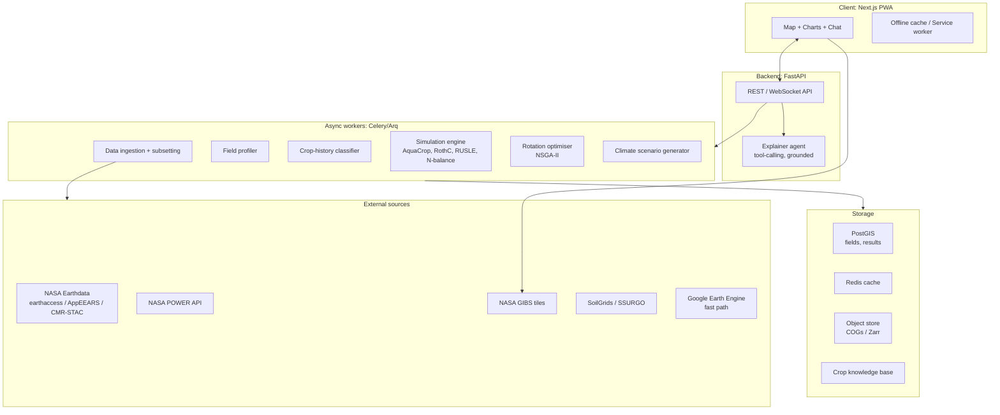

# Build Plan: NASA Crop Rotation Decision-Support Tool

**Working name:** *TerraLoop* (other options: *RotaSense*, *Furrow*, *Living Roots*)

> **One-line pitch:** Drop a pin on your field. From satellite records we work out what you grew over the last 5 years, how your soil and water are changing, and what the climate will probably look like. Then we simulate thousands of rotations and show you the 3 that best fit *your* priorities, explaining why in your own language.

---

## 1. How we beat everyone else

Most teams will build "a dashboard showing NDVI and rainfall plus a rule-based crop suggestion." We go further on five points:

| # | Differentiator | Why judges care |
|---|---|---|
| 1 | **Zero-input onboarding:** we infer field boundaries and **past crop history** from satellite time series | Feels like magic and shows deep use of NASA data |
| 2 | **Real process-based simulation** (FAO AquaCrop, soil carbon, erosion), not just if/else rules | Scientific *validity* |
| 3 | **Future-climate stress testing** with NASA NEX-GDDP-CMIP6 projections plus historical weather ensembles | Directly addresses "adapt to changing conditions" |
| 4 | **Multi-objective optimisation with farmer priorities** (Pareto trade-offs between profit, water, soil and risk) | Addresses "farmer priorities"; real decision support, not one fixed answer |
| 5 | **Grounded, multilingual, voice-first explanations** that work offline or over WhatsApp | *Impact* and inclusivity for smallholders worldwide |

Every number shown in the app carries a **data provenance chip** (e.g. `SMAP L4 · 2015–2025`), so judges can see exactly where NASA data drives each decision.

---

## 2. User journey (the experience we're building)

```mermaid
flowchart LR
    A["Pin / draw field<br/>or auto-detect boundary"] --> B["Field Report Card<br/>soil, water, climate, history"]
    B --> C["Confirm inferred crop history"]
    C --> D["Set priorities<br/>sliders / chat / voice"]
    D --> E["Engine simulates<br/>thousands of rotations x climate scenarios"]
    E --> F["Top 3 strategies<br/>side-by-side + Pareto view"]
    F --> G["What-if lab<br/>drought, +2C, price shock"]
    G --> H["Export plan<br/>PDF / share link / WhatsApp"]
    H --> I["Season monitor<br/>live alerts (stretch)"]
```



**Key screens**
1. **Map landing:** global map (MapLibre + NASA GIBS layers), search, GPS button, and "Try a demo field."
2. **Field Report Card:** soil texture/SOC/pH, root-zone moisture trend, rainfall anomaly, heat-stress days, groundwater trend, erosion risk, and the 5-year inferred crop history strip.
3. **Priorities:** rank or slide *Profit · Water savings · Soil health · Low risk · Low labour · Food security*, plus constraints (must grow X, irrigation available, livestock, market access).
4. **Recommendations:** 3 strategy cards, each with a seasonal Gantt timeline, 10-year SOC trajectory, water-use vs. availability chart, yield risk bands (P10/P50/P90), profit range and a soil health radar.
5. **Trade-off explorer:** interactive Pareto scatter. Click any point to see its rotation.
6. **What-if lab:** sliders for climate scenario (SSP2-4.5 / SSP5-8.5, 2030/2050), drought year, irrigation cap, fertiliser price, crop price.
7. **"Ask TerraLoop":** chat/voice assistant grounded on the engine's outputs.
8. **Report:** printable PDF with provenance appendix, sized for extension officers.

---

## 3. System architecture



**Stack**
- **Frontend:** Next.js (App Router), TypeScript, Tailwind, MapLibre GL + deck.gl, ECharts or visx, next-intl (i18n), PWA (Workbox).
- **Backend:** Python 3.11, FastAPI, Pydantic, Celery or Arq with Redis, PostGIS.
- **Geo/science:** `earthaccess`, `xarray`, `rioxarray`, `rasterio`, `geopandas`, `pystac-client`, `aquacrop` (AquaCrop-OSPy), `pymoo`, `scikit-learn`/`lightgbm`, `numpy`/`numba`.
- **LLM:** any capable tool-calling model. It may only state numbers returned by engine tools.
- **Infra:** Docker Compose for local dev. Deploy frontend on Vercel and backend on Fly.io/Render/Cloud Run. Store precomputed demo data in object storage.

---

## 4. Data layer

### 4.1 NASA Earth observations (the core)

| Dataset | Product | Resolution | What we use it for |
|---|---|---|---|
| **NASA POWER** (Agroclimatology) | REST API | ~0.5°, daily, 1981+ | Tmax/Tmin, solar radiation, RH, wind, rain → AquaCrop weather inputs, GDD, ET₀, heat-stress days. *Easiest win, no auth.* |
| **GPM IMERG** | `GPM_3IMERGDF` | 0.1°, daily | Rainfall totals, anomalies, extreme-rain events, RUSLE R-factor |
| **SMAP** | `SPL4SMGP` (L4 root zone), `SPL3SMP_E` | 9 km | Root-zone moisture trends, drought onset, planting-window timing, model calibration |
| **MODIS** | `MOD13Q1` NDVI/EVI, `MOD16A2` ET, `MOD11A2` LST, `MOD17A2H` GPP, `MCD12Q1` land cover | 250 m – 1 km | Long-history phenology (2000+), ET, canopy heat stress, productivity |
| **HLS** (Harmonized Landsat-Sentinel) | `HLSL30`, `HLSS30` | 30 m, ~2–3 day | **Field-scale** NDVI time series → crop history inference, cover-crop and fallow detection, bare-soil days |
| **ECOSTRESS** | L3 ET, L4 ESI | 70 m | Evaporative stress, water-use hotspots within field |
| **GRACE / GRACE-FO** | JPL Mascon + GSFC groundwater drought indicator | ~25–300 km | Groundwater depletion trends (e.g. Punjab), used as a water-sustainability penalty |
| **NEX-GDDP-CMIP6** | Downscaled projections | 0.25°, daily | Future climate scenarios (SSP2-4.5/5-8.5, 2030s/2050s) for stress testing |
| **GLDAS / NLDAS** | Noah LSM | 0.25° / 0.125° | Gap-filling soil moisture, temperature, runoff |
| **NASADEM / SRTM** | DEM | 30 m | Slope and LS factor → erosion risk, waterlogging risk |
| **FIRMS** | MODIS/VIIRS active fire | 375 m – 1 km | Detect residue burning, which feeds the soil health score and advice |
| **SMAP L4 Carbon** | `SPL4CMDL` | 9 km | Regional carbon flux context for SOC narrative |
| **NASA GIBS** | WMTS tiles | n/a | Instant visual basemap layers in the UI |
| *Optional:* OCO-2 SIF, Crop-CASMA | n/a | n/a | Photosynthesis signal; US crop condition cross-check |

**Access strategy** *(decided: any tooling is fine as long as the data is NASA's)*
- **Primary: Google Earth Engine.** It hosts the NASA collections we need (MODIS, SMAP, GPM IMERG, Landsat/HLS, NEX-GDDP-CMIP6, GLDAS, SRTM/NASADEM, FIRMS). It's the fastest way to get bulk time series and zonal stats.
- **Direct NASA access:** `earthaccess` / AppEEARS / CMR-STAC for anything GEE lacks or lags on, e.g. SMAP L4, GRACE-FO mascons, ECOSTRESS and the latest HLS. NASA POWER via its REST API.
- **Attribution rule:** every dataset is credited by its **NASA product ID + DOI** on the project page and in-app, whichever tool fetched it, so judges see "NASA data" everywhere.
- **Caching:** convert subsets to Cloud-Optimized GeoTIFF/Zarr per tile and cache by `(dataset, tile, date-range)`. Precompute everything for the demo regions.

### 4.2 Local soil information
- **SoilGrids 2.0 (ISRIC):** global 250 m SOC, texture, pH, bulk density, CEC, N, at 6 depths.
- **gSSURGO** (US) for higher detail where available.
- **Farmer soil test upload:** manual entry, or **photo/OCR of a soil test report** (e.g. India's *Soil Health Card*). Measured values override modelled ones.
- Derived: field capacity, wilting point, saturation (pedotransfer functions) → AquaCrop soil profile; K-factor → RUSLE.

### 4.3 Crop characteristics knowledge base
A curated, versioned JSON/YAML store with **30–50 crops** covering cereals, legumes, oilseeds, tubers, vegetables, cover crops and green manures:
- Botanical family (for pest/disease break rules), photoperiod, GDD to maturity, temperature thresholds
- FAO-56 Kc curve, rooting depth, water requirement, drought/heat/waterlogging tolerance
- N fixation (legumes), N demand, residue amount and C:N ratio
- AquaCrop parameter file mapping
- Typical yields, input costs, prices (FAO GIEWS FPMA, USDA NASS, India Agmarknet/MSP)
- Allelopathy and known good/bad predecessors (e.g. brassica before wheat is good; soybean after soybean is bad)
- Sources: FAO ECOCROP, FAO-56, AquaCrop defaults, USDA PLANTS, extension literature

### 4.4 Crop masks and history ground truth
USDA **Cropland Data Layer** (US), **ESA WorldCereal**, and GFSAD30. These provide training labels for the history classifier and validation for our inference.

---

## 5. Intelligence engine (the core IP)

### 5.1 Field Profiler
Input: polygon or point. Output: a `FieldProfile` object.
- Climate normals and trends (1991–2020 vs. last 10 yrs): temperature, rain, heat days, dry spells, onset/withdrawal of the rainy season
- Water: SMAP root-zone percentiles by month, ET deficit, GRACE groundwater trend, irrigation flag
- Soil: texture, SOC, pH, AWC, slope, erosion class
- Hazards: drought frequency, extreme-rain frequency, frost risk, heat-stress probability during key crop stages

### 5.2 Field boundary and crop history inference ("we know what you grew")
- **Boundaries:** pretrained field-delineation model (e.g. Fields of The World baseline, or SAM-based segmentation on HLS/Sentinel-2 composites). Users can edit the polygon.
- **History:** extract the HLS 30 m NDVI/EVI time series for 5–8 years, then smooth it (Savitzky-Golay/Whittaker).
  - Detect **number of seasons per year** (peak detection) and **phenology metrics** (SOS, POS, EOS, amplitude, integral).
  - Classify crop type per season with LightGBM on phenology + spectral features, trained on CDL/WorldCereal labels. Fall back to crop groups (cereal / legume / fallow / rice) where confidence is low.
  - Detect **bare-soil days**, **cover crops**, **residue burning** (FIRMS) and **flooded rice** (water indices).
- Show the result with confidence. Farmers confirm or correct it in one tap, which also builds a labelled dataset.

### 5.3 Simulation engine (per rotation, per climate scenario)
| Model | Purpose | Implementation |
|---|---|---|
| **AquaCrop-OSPy** | Daily yield, irrigation demand, water productivity, soil-water balance | Python package; weather from POWER/CMIP6, soil from SoilGrids, crop params from KB, multi-season sequential runs carrying over soil water |
| **Soil carbon (RothC-lite)** | 10–20 yr SOC trajectory from residue inputs, tillage, cover crops | Monthly RothC implementation in numpy |
| **RUSLE erosion** | Annual soil loss (t/ha/yr) | R from IMERG intensity, K from soil, LS from DEM, C from rotation cover calendar, P from practices |
| **Nitrogen balance** | N surplus/deficit, fertiliser need, legume credit | Simple mass balance per season |
| **Living-root & cover days** | % of year with living roots / ground cover | From rotation calendar, validated against HLS greenness |
| **Pest/disease break** | Penalty for same-family repeats | Rule set from KB |
| **Economics** | Gross margin range | Yields × price distributions − input costs |

**Soil Health Score** maps outputs onto the **5 USDA-NRCS soil health principles**: minimise disturbance, maximise cover, maximise biodiversity (Shannon index of crop families), maximise living roots, integrate livestock. Judges and agronomists will recognise the framework.

### 5.4 Climate scenario generator
- **Historical ensemble:** replay each of the last 20–40 years (POWER) as possible "next years."
- **Future ensemble:** NEX-GDDP-CMIP6 for 5+ GCMs × 2 SSPs × 2 horizons, bias-corrected to local POWER climatology (quantile mapping).
- Output: N weather sequences per field (e.g. 50). Every rotation is evaluated across all of them.

### 5.5 Rotation optimiser
- **Search space:** rotation length 2–5 years × seasons/year (auto-detected, e.g. Kharif/Rabi/Zaid) × candidate crops filtered by agro-climatic suitability.
- **Hard constraints:** calendar feasibility (GDD fits the window), water availability cap, no same-family back-to-back, must-grow crops, labour/machinery limits.
- **Objectives (multi-objective NSGA-II via `pymoo`):**
  1. Expected profit
  2. Water use / groundwater draw
  3. Soil health score (SOC Δ, erosion, cover days)
  4. Downside risk (CVaR of profit or yield across scenarios)
  5. Optional: food self-sufficiency, nitrogen surplus, emissions
- **Speed tricks:** a fast **surrogate model** (gradient boosting trained on AquaCrop runs) screens thousands of candidates, then full simulation runs only on the Pareto front. Cache per agro-climatic zone.
- **Farmer priorities → selection:** pick from the Pareto front using weighted distance to an ideal point. Weights come from sliders, AHP pairwise comparisons, or the chat elicitation.
- **Baseline comparison:** always compare against the farmer's *current* inferred rotation, so results read as "vs. what you do today."

### 5.6 Resilience and risk outputs
- Yield/profit P10/P50/P90 bands, probability of crop failure, worst-year profit
- **Resilience score:** how much performance degrades from historical to 2050 SSP5-8.5
- "Regret" analysis: how bad each strategy is if the wrong climate future happens

### 5.7 Explainability layer
- Deterministic **"why" cards** generated from engine outputs, e.g.: *"Swapping summer rice for maize reduces irrigation demand by 38% (AquaCrop), which matters because GRACE-FO shows groundwater here falling ~1.2 cm/yr."*
- **LLM explainer** with tool calls to the engine (`get_field_profile`, `compare_strategies`, `run_what_if`). Guardrails: it cannot invent numbers, every number must come from a tool result, and every answer includes citations.
- Multilingual (English, Hindi, Punjabi, Spanish, Swahili, Portuguese, French) and voice in/out.

---

## 6. Farmer priorities and personalisation
- Three input modes: **sliders**, a **"choose between two farms" pairwise game** (AHP, intuitive for low-literacy users), and **conversational elicitation** ("What worries you most about next season?").
- Constraints capture: irrigation source and reliability, farm size, livestock, machinery, labour, cash-flow timing, market access, cultural/subsistence crops.
- Personas for testing: *Punjab rice-wheat farmer*, *Iowa corn-soy grower*, *Kenyan smallholder (maize-bean)*, *Brazilian Cerrado soy-maize producer*.

---

## 7. Reach and accessibility
- **PWA with offline mode:** the field report and plan are cached on device.
- **WhatsApp/SMS bot:** send a location pin and receive a summary plus PDF (Twilio/Meta Cloud API).
- **Voice-first** flow for low-literacy users.
- **Extension-officer mode:** manage many farmers' fields, batch reports, regional view.
- WCAG AA contrast, large touch targets, works on low-end Android over 3G (lazy-load maps, compressed payloads).

---

## 8. Scientific validation (this wins the *Validity* criterion)
1. **Crop-history classifier:** accuracy/F1 against USDA CDL (US) and WorldCereal (global). Report a confusion matrix.
2. **AquaCrop yields:** backtest simulated vs. reported yields (USDA NASS county, FAO/state stats for India). Report RMSE and R².
3. **Soil moisture:** compare the AquaCrop soil-water balance to SMAP root-zone moisture and report correlation.
4. **Known-truth sanity checks:** the engine should rediscover established agronomy, e.g. diversifying Punjab rice-wheat cuts water use, and adding a legume reduces N need.
5. **Expert review:** get 2–3 agronomists or extension officers to review outputs and quote them in the pitch.
6. **Real farmer feedback:** interview 5–10 farmers (local or remote) and include their quotes and the changes made in response.
7. A **methodology page** in the app that lists every dataset, model, assumption and limitation.

---

## 9. Lead story: Punjab rice-wheat (deep dive)

### 9.1 Why Punjab is the perfect stage
Punjab hits every pressure in the challenge statement at once, and each one is visible in NASA data:

| Pressure (challenge wording) | Punjab reality | NASA evidence we show |
|---|---|---|
| Water shortages | Paddy irrigation from tube wells is drawing groundwater down fast. NASA's own GRACE study (Rodell et al., *Nature* 2009) found ~4 cm/yr groundwater loss across NW India | **GRACE / GRACE-FO** water-storage trend map, 2002 → today |
| Declining soil health | Two cereals every year with no break crop, heavy N use, residue burnt instead of returned → low SOC | **HLS/MODIS** NDVI showing the 2-season cereal loop and bare-soil gaps; **SoilGrids** SOC |
| Extreme weather | Heat waves in March hit wheat grain-fill; erratic monsoon; floods | **NASA POWER** heat-day trends, **GPM IMERG** extreme-rain days, **SMAP** moisture anomalies |
| Shifting temperatures | Warming at wheat's sensitive stages | **NEX-GDDP-CMIP6** 2030s/2050s projections |
| Air/soil harm from residue | Stubble burning every Oct–Nov between rice harvest and wheat sowing | **FIRMS** active-fire detections on/near the field |

### 9.2 Golden fields (precomputed, demo can't fail)
Three Punjab fields with **different conditions**, to prove the tool doesn't give everyone the same answer:
1. **Sangrur / central Punjab:** severe groundwater decline, intensive rice-wheat. *Hero field.*
2. **Ludhiana:** near Punjab Agricultural University (PAU), good for expert validation.
3. **Bathinda / south-west:** cotton belt, sandier soils, saline groundwater and waterlogging pockets. Recommendations should differ.

Plus **1–2 global fields** (Iowa corn-soy and a Kenyan smallholder) in a "works anywhere" montage. The challenge says *farmers around the world*, so this protects the **Relevance** score.

### 9.3 Baseline vs. candidate strategies the engine must evaluate
The engine decides the winners. These are the candidates we make sure it can represent and simulate:

| Strategy | Kharif (Jun–Oct) | Rabi (Nov–Apr) | Zaid (Apr–Jun) | Expected trade-off |
|---|---|---|---|---|
| **Baseline** | Puddled transplanted rice | Wheat (after residue burning) | Fallow | High profit and assured MSP procurement, very high water use, SOC decline |
| A: Smarter rice | Short-duration rice (e.g. PR-126) / direct-seeded rice | Wheat, residue retained (Happy/Super Seeder) | Summer moong (mung bean) | Lower water, N credit from legume, no burning, profit close to baseline |
| B: Maize switch | Maize | Wheat | Moong | Big water saving, lower/riskier profit (market) |
| C: South-west | Cotton | Wheat / mustard | Fallow or moong | Fits sandier, saline areas |
| D: Diversified | Maize or basmati | Potato / mustard → spring crop | n/a | Higher diversity and profit potential, more labour |

Policy-aware context the explainer should mention: Punjab's **Preservation of Subsoil Water Act (2009)** delays paddy transplanting to mid-June, MSP procurement favours rice and wheat, and state crop-diversification incentives exist. Farmer **priorities** decide where on the Pareto front each farmer lands.

### 9.4 Punjab-specific validation and partners
- **Groundwater:** compare the GRACE trend with **CGWB** observation-well levels (India-WRIS).
- **Yields:** backtest AquaCrop against district rice and wheat yields (**ICRISAT District Level Database**, state agriculture statistics).
- **Crop history:** check HLS-inferred rice/wheat seasons against **ESA WorldCereal** maps and farmer confirmation (India has no equivalent of the US CDL).
- **Burning:** compare FIRMS counts with Punjab Remote Sensing Centre / PPCB season reports.
- **Experts:** PAU Ludhiana agronomists and the local **Krishi Vigyan Kendra (KVK)** for review and quotes.
- **Farmers:** 5–10 interviews (in Punjabi) to test the priorities UI and the wording of explanations.
- **Languages:** **Punjabi (Gurmukhi), Hindi, English** are mandatory. Others are a bonus.

---

## 10. Space Apps submission and pitch strategy

### 10.1 Format rules to design around
- Project demo is **either a 30-second video or a maximum of 7 slides**, in English (English subtitles if the video uses another language).
- Judges review the **project page** for most of the work, so it must be complete: description, NASA data used, tools, AI use, repo and live links.
- Judging criteria: **Impact · Creativity · Validity · Relevance · Presentation.**

### 10.2 Recommended: 30-second video (higher impact than slides for a visual product)
| Time | Shot | Criterion hit |
|---|---|---|
| 0–6 s | GRACE groundwater-loss map over Punjab + FIRMS fire dots. Text: *"Punjab's farms are running dry."* | Impact, Relevance |
| 6–12 s | A farmer drops a pin, and the 5-year rice-wheat history appears from space | Creativity |
| 12–20 s | Priority sliders (in Punjabi) → engine runs → 3 strategy cards + Pareto chart | Validity, Creativity |
| 20–26 s | Side-by-side numbers: water use, SOC over 10 yrs, profit range, 2050 climate stress | Impact, Validity |
| 26–30 s | Global montage (Iowa, Kenya) + name + "Built on 10+ NASA datasets" | Relevance, Presentation |

Also prepare a **7-slide deck** as backup, and a longer **2–3 min walkthrough** linked from the project page/repo for judges who want depth.

### 10.3 Project page checklist
- Problem → solution → how it works (architecture diagram) → NASA data table with product IDs/DOIs → validation results → farmer/expert quotes → limitations → future work → team.
- Live URL that opens straight onto the Sangrur hero field (no login).

### 10.4 Narrative line
*"From space, we can see Punjab's water vanishing and its fields burning. TerraLoop turns that same NASA data into a rotation plan each farmer can trust, explained in their own language."*

---

## 11. Priority tiers (by importance, not time)

**🟥 Must have (core winning loop + Punjab story)**
- Map + field pin/draw, Field Report Card from POWER, IMERG, SMAP, MODIS/HLS, SoilGrids, DEM
- **GRACE groundwater trend + FIRMS burning signals** (the Punjab hook)
- **Rice/wheat season detection** from HLS/MODIS NDVI for the golden fields
- Crop knowledge base (≥20 crops, all Punjab candidates included: rice/DSR, wheat, maize, moong, cotton, mustard, potato, basmati)
- AquaCrop multi-season simulation + RUSLE + SOC-lite + N balance
- Historical climate ensemble
- Rotation optimiser with priority sliders, top-3 strategies vs. current baseline
- Provenance chips + methodology page
- English + **Punjabi** UI
- 3 Punjab golden fields precomputed, deployed live URL, 30-second video

**🟧 Should have (what puts us ahead)**
- General HLS crop-history inference with confirm/correct (any region)
- NEX-GDDP-CMIP6 future scenarios + resilience score
- Pareto trade-off explorer + What-if lab
- Grounded LLM explainer, Hindi + voice
- Global golden fields (Iowa, Kenya)
- PDF report export, validation metrics published

**🟨 Could have (wow factor)**
- Automatic field boundary detection
- WhatsApp bot, offline PWA
- Soil Health Card OCR upload
- Extension-officer multi-field dashboard and regional heatmap
- ECOSTRESS within-field stress map

**🟦 Moonshots**
- **Season monitor:** after a plan is adopted, live NDVI/SMAP alerts ("soil moisture is below the stress threshold for your maize at tasseling")
- **Community learning:** anonymised farmer outcomes improve recommendations
- **Carbon-credit readiness estimate** from SOC gains
- 3D field "digital twin" terrain view with layers (deck.gl terrain)

---

## 12. Workstreams (parallel ownership, any team size)

| Workstream | Owns |
|---|---|
| **Data Engineering** | Ingestion clients, subsetting, caching, COG/Zarr store, golden-field precompute |
| **Earth Observation / ML** | Crop-history classifier, field boundaries, phenology, validation vs. CDL/WorldCereal |
| **Agronomic Modelling** | Crop KB, AquaCrop setup, RothC, RUSLE, N balance, soil health score |
| **Optimisation & Risk** | Climate ensembles, CMIP6 bias correction, NSGA-II, surrogate model, risk metrics |
| **Backend/Platform** | FastAPI, workers, PostGIS, auth, deployment, observability |
| **Frontend/UX** | Map, report card, strategy cards, charts, what-if lab, i18n, PWA |
| **AI/Explainability** | Grounded LLM agent, why-cards, voice, WhatsApp |
| **Validation & Storytelling** | Backtests, PAU/KVK expert and farmer interviews, 30-s video, deck, project page |

Interface contracts between workstreams (agree on these first so everyone can build in parallel with mocks):
`FieldProfile`, `CropSpec`, `Rotation`, `ScenarioSet`, `SimulationResult`, `StrategyRecommendation` (Pydantic models shared as JSON Schema → TypeScript types).

---

## 13. Proposed repo structure
```
NASA/
├── apps/
│   ├── web/                 # Next.js PWA
│   └── api/                 # FastAPI app
├── packages/
│   ├── engine/              # Python: profiler, simulation, optimiser, risk
│   │   ├── data/            # NASA + soil clients (GEE, earthaccess, POWER, AppEEARS)
│   │   ├── eo/              # phenology, crop-history classifier, boundaries
│   │   ├── models/          # aquacrop_runner, rothc, rusle, nbalance, soil_health
│   │   ├── climate/         # ensembles, CMIP6 bias correction
│   │   ├── optimize/        # nsga2, surrogate, priority selection
│   │   └── explain/         # why-cards, LLM tools
│   ├── crop-kb/             # YAML crop specs + sources
│   └── schemas/             # shared Pydantic → JSON Schema → TS types
├── workers/                 # Celery/Arq tasks
├── notebooks/               # exploration + validation reports
├── data/golden/             # precomputed demo fields (Sangrur, Ludhiana, Bathinda, ...)
├── docs/                    # methodology, datasets, architecture
└── docker-compose.yml
```

---

## 14. Risks and mitigations
| Risk | Mitigation |
|---|---|
| Earthdata/GEE latency or outages during demo | Precomputed golden fields, Redis/object cache, two access paths |
| AquaCrop too slow for thousands of rotations | Surrogate model screening, zone-level caching, numba, parallel workers |
| Coarse data (SMAP 9 km, GRACE) vs. field scale | Use them as context/trend signals and HLS 30 m for field-level detail; state resolution limits openly |
| No CDL-style crop labels in India | WorldCereal + farmer confirmation + crop-group fallback, show confidence |
| Puddled rice / DSR not native in AquaCrop defaults | Calibrate rice parameters from PAU literature; model puddling as a soil-water/percolation adjustment |
| Price/MSP assumptions skew the profit ranking | Show profit as a range, expose price sliders in What-if lab |
| LLM hallucination | Tool-only numbers, citation enforcement, deterministic why-cards as primary |
| 30 s is too short to show depth | Script the video tightly (§10.2), put depth on the project page + linked longer walkthrough |
| Scope creep | Tiers in §11: always ship a polished Must-have loop before moving to Should-haves |

---

## 15. Submission checklist
- [ ] Live deployed URL opening on the Sangrur hero field
- [ ] Public repo with README, architecture diagram, setup instructions, license
- [ ] Dataset list with NASA product IDs and DOIs, plus non-NASA sources credited
- [ ] Methodology and limitations page
- [ ] Validation results (classifier F1, yield RMSE, GRACE vs. CGWB wells, SMAP correlation)
- [ ] 30-second demo video (English / subtitled) **or** ≤7-slide deck, plus backup of the other
- [ ] Space Apps project page fully completed
- [ ] PAU/KVK expert + farmer quotes
- [ ] Use-of-AI disclosure
